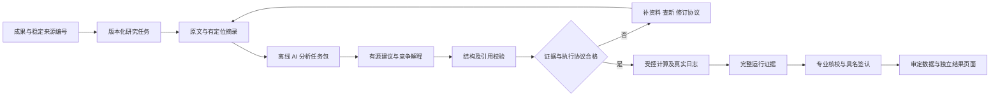

# 平台架构与本轮开发

定位：用 AI 辅助重建陈庆云与合作者的研究证据、复核可重算内容，并提出能够被检验的新问题。历史贡献、已有后续研究、平台复算和未来假设分别归属。当前选择离线工作流，不接模型 API。

## 已有架构与缺口

| 层次 | 原有实现 | 本轮补充 |
|---|---|---|
| 公开成果 | `site/` 九条成果与传承线、51 条来源，Pages 只发布原 18 文件 | 保持正文与编号；研究工作区独立，不把待审材料自动上站 |
| 任务登记 | 原队列 8 项、PF-04 另在文档 | `research/tasks.v1.json`，12 项覆盖 A01–A09；区分工作类型、缺口、验收及执行器 |
| 资料证据 | 已有来源书目与固定表格 | 本地摘录登记，具体页表／档案定位、材料类型、实际字节指纹及未核校状态 |
| AI 辅助 | 路线图与人工使用 AI 整理 | 导出来源绑定的研究任务包，导入严格结构化建议；核对引文、定位、版本及指纹 |
| 计算执行 | `chen_research` 单一固定数值算例 | `chen_workbench` 单 worker 队列、硬时限、取消、失败与事件链，复用原严格引擎 |
| 审阅发布 | 具名签认门禁与审定导出，策略关闭 | 计算完成仍待审，继续交原签认流程；本轮不假造专家批准 |

图中的完整科研闭环是目标；本轮实际完成到离线工作流和受控固定重放。原扫描专业核校、真实具名签认、审定结果的前端消费仍待补。

## 模块及信任边界

新增 `chen_workbench/` 包，保留 `chen_research/` 原字节。后者将整个原包代码绑定到已归档运行；把平台模块放在独立包中，可避免增加平台功能时使旧固定算例的代码集合悄然变化。

`common.py` 管理严格 JSON 和本地工作区；`catalog.py` 管理版本化任务与资格；`evidence.py` 管理有定位摘录；`ai_exchange.py` 管理分析包与建议；`jobs.py` 管理受控执行；`report.py` 生成只读概览。入口为 `python3 -m chen_workbench`。

项目内工作区只能放入被 Git 忽略的 `scratch/`，原文摘录、个人分析、运行日志不自动进入 GitHub 或 Pages。工作区也可使用项目之外的独立目录。正式公开证据由维护者按许可和科学状态另行选择归档。测试文件继续仅留本机。

来源书目是元数据登记，不代表已取得原文。材料即使标作 `primary_excerpt`，也只是用户提供的原文摘录声明，仍为 `user_supplied_unverified`，不能自动成为专业签认。AI 请求将题录、摘要、原文摘录和封存转录分开标注；导入的引文必须能在绑定材料中逐字找到。

AI 负责提取、消歧、竞争解释、反例和可证伪观测；计算程序负责实际数值。导入程序不执行建议、脚本或 shell，不把 `hypothesis` 改成已验证事实，不因模型说“可以计算”而批准任务。没有原文的任务仍可以导出资料计划，不能用空引文提交事实性断言。

## 工作类型与当前范围

| 类型 | 本轮入口 | 进入验证的条件 |
|---|---|---|
| 原表数值重放 | PF1966-UV-T1，可入队 | 固定原表、原协议与原作者；完成后仍待科学审阅 |
| 文献与论证重建 | A01、A02、A06、A07、A08 | 原文、结构、条件、原子映射与专业核校；不能叫实验复现 |
| 已发表计算复算 | PF-03 | 指定全文／SI、结构、方法、状态、资源与验收协议；原成果归原作者 |
| 现代模型检验 | PF-02 | 可观测量、模型／溶剂／电子态、负对照与敏感性；不能以基态能量代替吸收峰位 |
| 未来研究 | PF-04 及各线后续问题 | 竞争解释、系统查新、否证判据和新增数据，未检验时不称首次或发现 |
| 工程史料与传承 | A04、A05、A09 | 原始工况、物料、作者／角色和档案定位；不由分子计算推算厂试收益或师承关系 |

原论文的三种碘代物与溶剂位移仍以[1966 年原刊](https://sioc-journal.cn/Jwk_hxxb/CN/Y1966/V32/I1/18)及已封存输入为依据。本轮不新增实验结论；现代计算与未来设想不能反向写成陈先生当年的研究方法。

## 运行治理

执行白名单当前只有 `PF1966-UV-T1`／A03／PF01，固定调用原严格引擎，不接受用户命令。入队绑定任务登记、输入、原研究包和工作台代码；运行前后重新核验。每次生成新 UUID 和独立目录，exit 0 后仍须完整 `verify_run()` 通过才标为 `completed`。

每个任务限定墙钟时间，当前固定任务上限 120 秒、全局最多 300 秒；操作员只能缩短。单 worker 排他锁防止同一工作区重复执行。事件保存 `queued`、`running`、`completed`、`failed`、`cancelled`、`timed_out`，并以哈希链关联；真实 stdout、stderr、退出码、运行清单保留。取消先记录请求，再由 worker 实际终止。异常中断保留锁供维护者调查，不自动清除其他进程的锁。

这不是操作系统级内存沙箱、量化集群或多机调度器。AI 平台模型调用数为 0；本轮使用外部 Codex／研究者辅助分析交付，再由程序校验和归档。

下一轮优先补 PF-02／PF-03 的原文、SI 和协议，以及 A01／A06 的具体原刊；在专业批准前不增加量化执行适配器。每个新适配器应有独立输入合同、软件身份、资源预算、失败判据和真实验收，再加入白名单。
