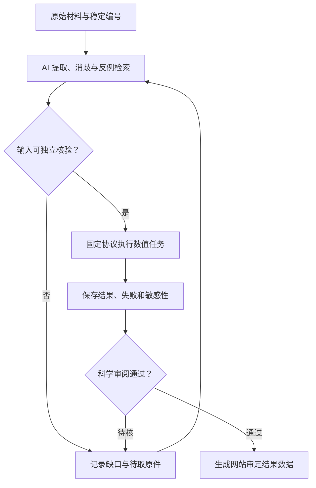

# 从早期成果到未来问题：研究路线图

日期：2026-11-11。定位为独立的研究候选方案，不改变已经通过本地复验的 YouMind 网站及其 51 条来源登记。

## 一、先把“复现”分清

| 类型 | 本平台可交付的内容 | 需要的证据 | 当前状态 |
|---|---|---|---|
| 文献与论证重建 | 研究对象、观察、作者解释、先行工作及反例的可追溯关系 | 原文、页码、明确的提取与核校记录 | 可继续建设；不能当作新的化学实验 |
| 原始数据数值重放 | 使用论文已发表输入独立重算差值、单位、拟合或账本 | 原始表格／数据、公式、单位、可运行程序 | 本包完成一项 PFtB 表格任务 |
| 已发表计算的数值复算 | 在已登记方法、状态、溶剂、几何及软件条件下重跑 | 原文和补充材料、实际运行日志、失败记录 | 尚未启动，不借用 AI4OrgChem 的验证结论 |
| 现代计算再检验 | 用预先登记的模型评估历史解释的适用范围 | 合适的可观测量、模型边界、负对照及不确定性 | 需要逐项建立协议；结果可以与原解释不一致 |
| 未来研究 | 由缺口提出能够证伪的问题，必要时与实验团队合作 | 系统查新、可执行计划、实际新增数据 | 下列均为待查新／待验证问题，不称首次 |

陈院士早期研究以实验为主，今天的计算是平台的新验证工具。历史贡献与现代解释各自署名；后人的模型不能反过来写成陈院士当年的计算工作。

## 二、首批成果线与实际入口

按“当前证据是否允许独立执行”排序，不代表科学贡献大小。各成果线单独归档。

| 成果线 | 首个具体任务 | AI 的作用 | 进入计算前的条件 | 首期判定 |
|---|---|---|---|---|
| A03，1966 PFtB | 重放三种碘代物的两组溶剂位移；比较 nm 与 cm⁻¹ 尺度 | 读图、实体核对、提出尺度与扰动反例 | 表 1 原扫描与页码已可核 | 本包已实际执行数值任务 |
| A01，1950 年代末—1960 年含氟羰基／特定共轭体系 | 核译两篇不同的 1960 年俄文论文；建立底物、判据和原始观察卡 | 双语对齐、图式识别、区分同年不同论文 | 取得并核对俄文正文；保留原文与译文定位 | 优先资料任务，尚不能报告复算结果 |
| A02，含氟单体及 1980 年调聚 | 从原刊确认产物与加成位置；为竞争加成路径建立原子映射 | 式子校对、底物／产物对照、查找反例 | 原刊结构式与实验条件；馆藏摘要有转录疑点 | 待全文，不生成区域选择性预测 |
| A06，1982／1983 磺酸酯 | 对照不同底物上的 C–O／S–O 断裂，形成逐反应的观察—解释矩阵 | 反应原子映射、条件拆分、竞争路径生成 | 两篇原刊及必要数据，逐个确认底物与亲核试剂 | 适合第二项机制研究，尚未开始量化计算 |
| A04，F-53 工业研究 | 分别核对集体署名、试制、厂试、当年效益测算 | 跨来源年代与单位核对、追踪数字口径 | 配方、批次、工况及实际运行基线 | 继续史料核校；不能由分子计算重现厂试收益 |
| A05，F-115／F-502 与 HFC-134a | 分开组分制备、中试与整机试用，追踪原始技术资料 | 同名物质与文献消歧、物料／日期核对 | 原论文、专利、介质组成和工况 | 尚不建立反应或产业规模预测 |

早期异常沸点的访谈涉及反应样品与乙醚的恒沸物。不能替换成六氟丙酮本体的沸点，更不能用单个气相分子能量解释混合物气液平衡。若以后做这一任务，需先确认产物、组成、压力与对应原始物性记录。

## 三、PFtB 下一阶段：从数值重放到可检验问题

### PF-02：原来比较的到底是什么

问题：论文的溶剂位移顺序，在多大程度上反映给体—碘代物相互作用，而不是可以独立搬用的“基团常数”？

1. 先保留三种完整碘代物、原表溶剂和同一观测量，不能把孤立阴离子的电子能直接当作紫外位移。
2. 补齐原文的溶剂、浓度、温度、峰位选取、谱带归属和仪器信息；缺失字段明确记缺失。
3. 量化计划分别考虑分子构象、给体结合位点、显式溶剂络合与连续溶剂近似，评估碘的重原子处理及激发态模型。
4. 用与原实验相对应的吸收可观测量验证，区分结合能、基态电荷、轨道能与实验峰位。算到低能结构不等于复现了光谱。
5. 给出模型能解释的部分、不能解释的部分，以及更换模型后是否发生顺序变化。先登记方案和排除标准，再运行。

相关先行工作包括已有的全氟烷基碘—Lewis 碱 UV／Raman／DFT 研究。其具体异构体、溶剂和底物范围仍须回到原文。不能把一般“用 DFT 研究卤键”称作本平台创新。

### PF-03：已发表阴离子计算的条件敏感性

先复算后拓展：取得 Zhu、Luo 等 2025 年 Nature Communications 论文及补充材料，复核一个明确登记的结构／能量对照。该研究已经包含阴离子晶体结构和 DFT；均归原作者。

该论文公开的计算段落注明为简化而未考虑反离子。因此“反离子及溶剂化是否改变某个指定比较”可作为候选问题。它只是一项有出处的敏感性问题，**尚未完成全面查新，也没有新计算结果**。模型需区分晶体盐、溶液离子对和孤立气相离子，不从一种状态直接推出另一种状态的稳定性。

### PF-04：选择下一项实验最需要什么证据

在数据足够后，让 AI 比较几种竞争解释，列出可区分它们的观测，而不是只建议更多底物。候选观测需事先写清：若出现什么结果，哪种解释会受到削弱；观测是否已有人报道；要新增哪些数据。实验设计由相应专业团队审核，本包不提供高风险物质的制备与放大规程。

## 四、已发现的先行工作如何限制创新主张

| 已有工作 | 已确认到的范围 | 对平台研究的约束 |
|---|---|---|
| Dixon、Fukunaga、Smart，1986，10.1021/ja00274a029 | 原始理论论文书目确认，题名涉及氟代碳负离子结构、稳定性与负超共轭 | 不能宣称首次计算氟代碳负离子稳定性；具体对象与方法需全文核对 |
| Wang、Tao 等／Hu 团队，2021，10.1002/anie.202113727 | 出版摘要、作者与 DOI；PFtB 阴离子试剂方法及特定成像示范 | 方法与应用归作者；不能把后续应用直接当作 1966 年机理验证 |
| Wei、Wen 等，2022，10.1021/jacs.2c10479 | 出版摘要、作者与 DOI；砜试剂、芳炔反应及特定探针 | 不把该路线和探针用途作为平台新发现 |
| Zhang 等／Chao Chen 团队，2025，10.1038/s41467-025-59772-5 | 已有全文资料；稳定试剂支持的自由基型 PFtB 引入 | “开拓自由基 PFtB 引入”这一宽泛目标已有成果；陈超与陈庆云分别消歧 |
| Zhu、Luo 等／Hu 团队，2025，10.1038/s41467-025-63180-0 | 出版摘要及计算段落摘录；单晶阴离子结构和 DFT | “首次看见 PFtB 阴离子结构”不成立；拟议计算须先与其补充材料对照 |
| Cheng、Wei、Ni、Hu 等，2026，10.1002/ijch.70047 | 出版方题录与摘要，2026-10-11 在线发表 | 取代芳基砜与不同亲电体的比较已有研究；不直接列为新试剂设计成果 |
| 黄广龙、薛小松，2024，10.6023/A23090434 | 已登记的陈试剂机理计算 | 仅放入已有研究对照；不计为陈院士早期计算，也不计为平台原创 |

本轮为网页与原始资料的定向检索，不是穷尽性查新。拟议研究在启动时还要补查结构别名、明确底物和状态、全文及补充资料、引证与被引证记录，以及可检索的预印本和学位论文。检索不到完全同题工作不等于证明“前所未有”。

## 五、AI 的迭代方式与停止条件

- 抽取出的化学式或小数无法从原扫描确认：停止该数据项，不让模型补齐。
- 缺少关键实验条件或原始量化计算输入：保持资料任务，不能升级为已复现。
- 与已有研究重合：承认并转为复算或敏感性研究，不重新命名为原创发现。
- 结果不支持预期：保留输出与失败，不自动改阈值追求一致。
- 计算资源超预算或态／几何未达预先判据：报告未完成，不输出伪精确结论。

## 六、阶段交付

1. **本期已经完成**：原文表 1 数据、固定计算、边界检查、9 项测试、本地结果与网站候选 JSON。
2. **下一期优先**：由化学审阅者确认转录；补取 A01 和 A06 原文；完成 PF-02／PF-03 的全文与补充材料对照及计算协议。
3. **计算协议通过后**：在独立环境执行少量基准，记录方法和失败，再决定是否扩展。不能把大模型回答当作量化计算输出。
4. **接入网站前**：在 Windows 11／WSL 2 正式重跑，形成审定结果；网站保留原始成果、平台复算、已有后续研究和未来假设四种身份。
