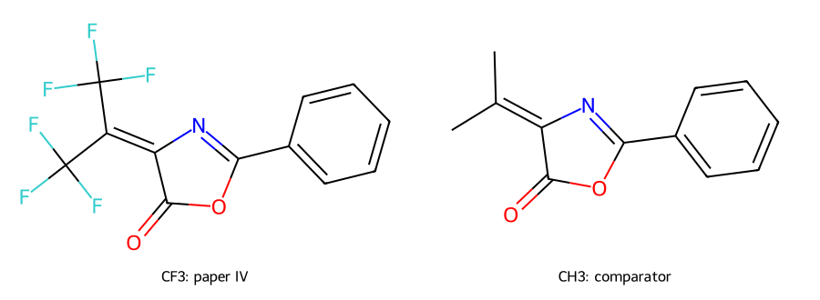

# A01 原始材料核读与首项研究结果

本轮已实际取得两篇原始论文 PDF，并逐页核读结构图和数据；另取得第 117491 号发明人证书的一页**说明书扫描**。后者来自第三方原图镜像，不是授予证书正页，本页未显示 1959 年落款。原件文件仅保留本机，公开来源定位和研究摘要；全部分析为 `review_required`。

## 原文带来的科学信息

**133(5):1113–1116**：化合物 I 的结构明确为 `(CF3)2C=C(COOC2H5)2`，是二乙酯。原作者以化学转化讨论双 CF₃ 与双酯基的竞争，提出酯基偏离共面的解释；这不是直接测得的扭转角。p.1115 将 I 的 1700 cm⁻¹ 带归属烯键，但未提供完整谱图和明确测量相态。[原始 PDF](https://www.mathnet.ru/links/45339c5078a0fc0eab6eab0df3527ff9/dan23922.pdf)

**134(6):1367–1370**：研究另一种噁唑酮 IV，分子式为 C₁₂H₅F₆NO₂；原文将其与两个 CF₃ 换为 CH₃ 的类似物比较。表 1 的四项星号情形有同条件“不反应”对照。作者对羰基电子密度的解释使用“推测”语气；没有定量速率。甲醇、乙醇的催化脚注也不能省略。[原始 PDF](https://www.mathnet.ru/links/5f0f232ab0ba1fe58f1d88f43738bbce/dan24193.pdf)

**117491 号说明书**：原图确认作者顺序为克鲁扬茨、陈庆云、甘巴里扬；申请为 1958-07-19，编号 604379/23。报告产物 21.7 g、98% 和熔点 161–162℃。此页没有结构图或现代谱学数据；双酚 AF 的图式与分子式须明确标为依据名称的现代解析，不能写成纸页上的结构图。[说明书原图镜像](https://img.poleznayamodel.ru/img_pat/357/3573210.jpg)

## 首项可实际开展的验证：双酚 AF 收率证据能否定量闭合？

选定并已执行 **A01-AF-YIELD-T1**：以说明书报告的有机原料和产物质量，按名称所指双酚 AF 的净计量关系重建收率账本，不复写实验操作。

在“纯物质、目标组成和所列质量按给定约定解释”的条件下，限制试剂为苯酚，理论产物约 21.7932 g，对应表观质量收率 **99.5723%**；原报告仍保留 **98%**。一位小数质量的显示舍入诊断范围约为 98.9374%–100.2125%，与原整数百分数的显示区间不重叠。

这是一个**待解释的原始证据缺口**：原收率的纯度、理论量基准和计算约定并未在此页充分说明。不能将本轮结果称作“校正真收率”，也不能据差异判定原作者错误。数据、假设和实际计算见 [双酚 AF 收率研究](bisphenol-af-yield/README.md)。

## 并行重建：折射性质是否相容？

**A01-MR-T1** 用原图折射率、相对密度与分子式重建摩尔折射。定义采用 [IUPAC 摩尔折射关系](https://goldbook.iupac.org/terms/view/M03979)，原刊“found MR”、原刊标为“计算 MR”的值和本轮重建分别保留；原刊所用的具体方法与常数未列，不代为确定。

| 同为20℃的对象 | 本轮整数质量约定 | 原刊 found MR |
|---|---:|---:|
| I | 53.7443 | 53.74 |
| V | 52.2821 | 54.90 |

I 在所选显示舍入诊断下相容；V 的现代质量结果为 52.3155，改变这两种质量约定和显示舍入仍不能解释全部残差，原因未定。IV 的 n 在19℃、密度在20℃，不作静默温度校正。详见 [折射性质研究](molar-refraction/README.md)。这些重建均不等于新实验或对共轭解释的证实。

## 首项现代模型任务：配对噁唑酮为何反应性不同？

选择 **A01-OX-M1**：用原文 CF₃／CH₃ 配对对象研究羰基加成及开环。已准备配对分子图、原子映射和起始坐标，尚未开展电子结构或势垒计算。[模型问题与协议草案](oxazolone-model/protocol-draft.json)／[配对结构](oxazolone-model/matched-pair.svg)。

首个对照选择原文苯介质中的苯胺反应，区分电子、空间和溶剂化影响；各自在原子守恒的反应体系内计算路径和势垒后再比较。水项实际在乙醚中，不能误设为均相水。单个电荷不能验证反应性，历史时长和分离收率不能拟成实验速率。方法、构象覆盖、质子转移、介质及过渡态资格须先固定；合理模型不支持原方向时应保留该结论。

因此，当前的科学产出是：原图与结构已落实、两项条件性数据重建已实际执行、两个定量差异得到明确限定，并形成有原实验对照的现代模型问题。实验复现、量化机理验证及专业签认仍待完成，原成果归原作者。
